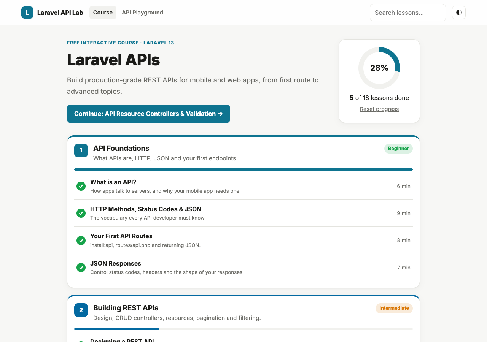
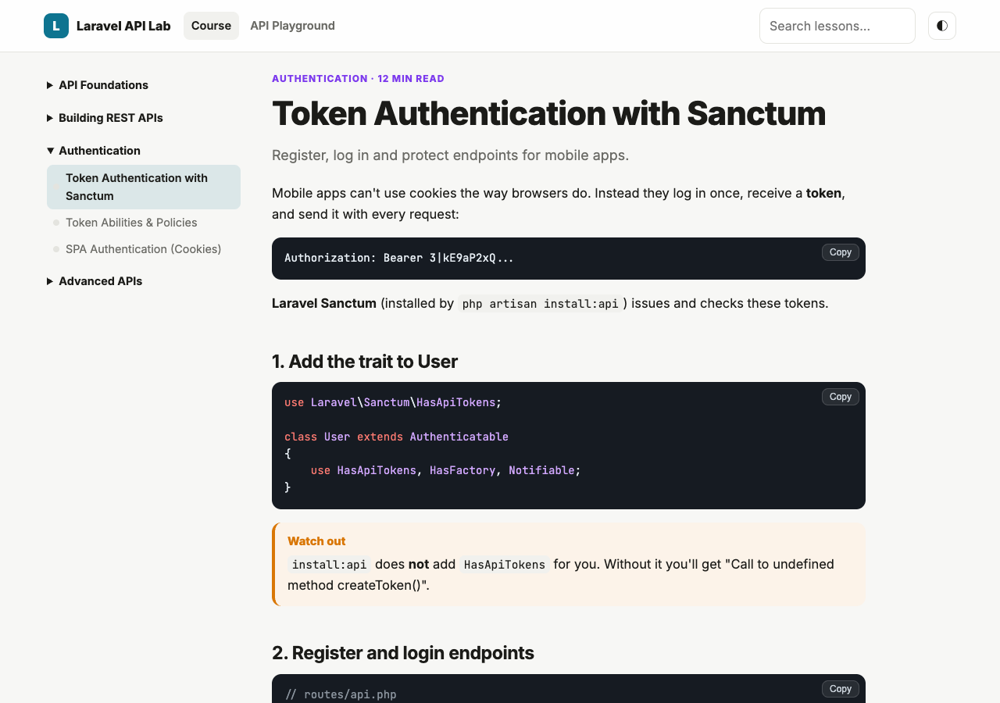
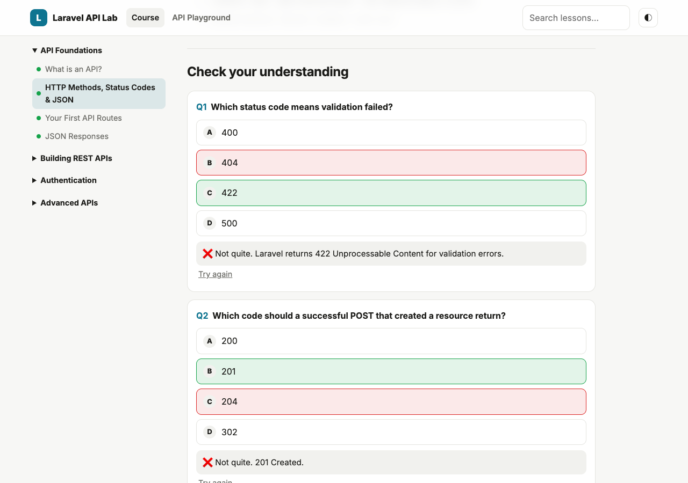
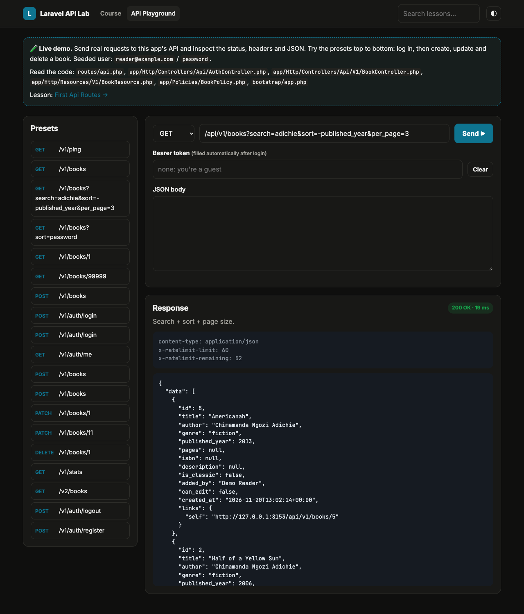
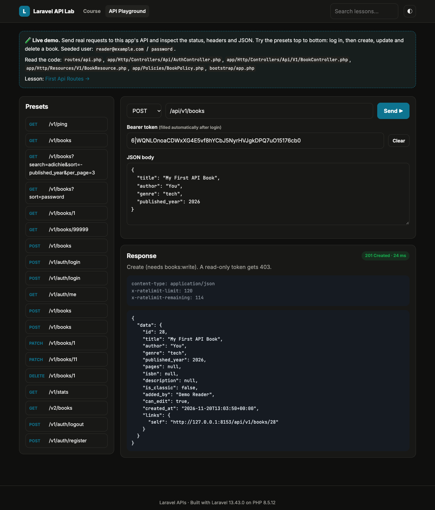
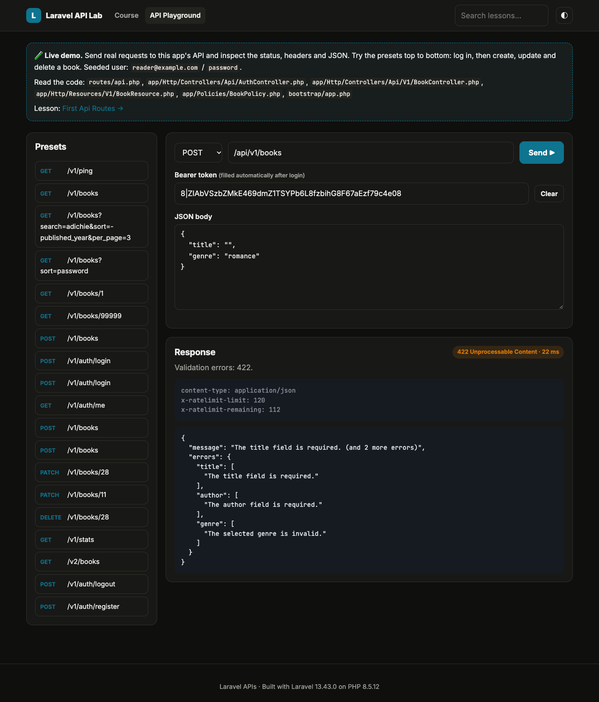
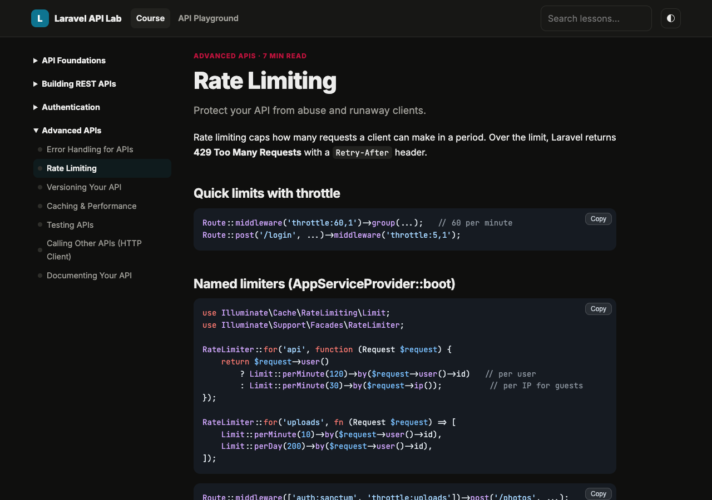
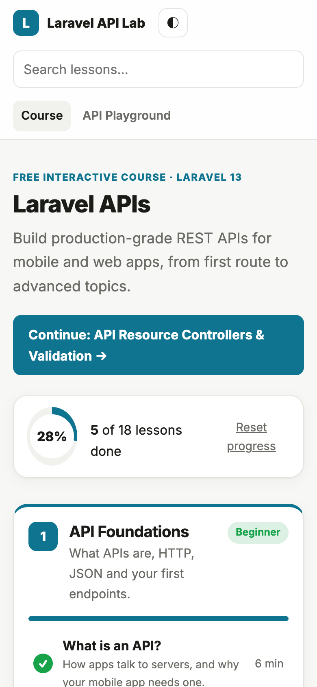

<div align="center">

# Laravel API Lab

**A website that teaches you to build APIs with Laravel 13, from your first route to production-grade topics.**

18 lessons with code and quizzes, a real **Books API** built the way the lessons teach, and an in-browser
**API Playground** for sending live requests and inspecting status codes, headers and JSON.




</div>

---

## Screenshots

| Lesson | Quiz with instant feedback |
|---|---|
|  |  |
| **Playground: search, sort and paginate** | **Playground: create a book (201)** |
|  |  |
| **Playground: validation errors (422)** | **Dark mode lesson** |
|  |  |

<p align="center"><br><sub><b>Mobile</b></sub></p>

---

## What's inside

### The course: 18 lessons, 41 quiz questions, about 2½ hours

| # | Module | Level | Lessons |
|---|---|---|---|
| 1 | API Foundations | Beginner | What is an API? · HTTP Methods, Status Codes & JSON · Your First API Routes · JSON Responses |
| 2 | Building REST APIs | Intermediate | Designing a REST API · API Resource Controllers & Validation · API Resources (Transformers) · Pagination, Filtering & Sorting |
| 3 | Authentication | Intermediate | Token Authentication with Sanctum · Token Abilities & Policies · SPA Authentication (Cookies) |
| 4 | Advanced APIs | Advanced | Error Handling for APIs · Rate Limiting · Versioning Your API · Caching & Performance · Testing APIs · Calling Other APIs (HTTP Client) · Documenting Your API |

Each lesson has syntax-highlighted code with copy buttons, tip/warning callouts and a quiz that explains each answer.
Progress is tracked in the session (no sign-up), and the site includes full-text **search** and a **light/dark** toggle.

### The Books API: every lesson made real

The project ships a working API that demonstrates each concept from the course:

| Concept | Where you see it |
|---|---|
| Resource controllers + Form Requests | `Api/V1/BookController`, `StoreBookRequest` / `UpdateBookRequest` |
| API Resources (transformers) | `Http/Resources/V1/BookResource` |
| Pagination, filtering, **whitelisted** sorting | `GET /books?search=&genre=&sort=-published_year&per_page=` (`?sort=password` → 422) |
| Sanctum tokens with **abilities** | Login returns a `books:read` + `books:write` token, or a read-only one with `read_only: true` |
| Policies (owner-only writes) | `BookPolicy`: editing someone else's book → 403 |
| Custom JSON errors | Friendly `{"message":"Resource not found.","code":"not_found"}` 404 in `bootstrap/app.php` |
| Rate limiting | Named limiters: `api` (60/min guest, 120/min per user) and `auth` (10/min) |
| Caching | `GET /stats` uses `Cache::remember` for 60 seconds |
| Versioning | `/api/v2/books` uses a different JSON shape and cursor pagination, side by side with v1 |

### The API Playground (`/playground`)

A Postman-style page inside the site. Pick one of 19 presets, from ping and list to log in, create, update, someone else's
book (403), delete, stats, v2 and logout. You can also edit the method, URL, token and JSON body yourself, then inspect
the status, rate-limit headers and pretty-printed response. The token is filled in automatically after login.

---

## Getting started

### Prerequisites

- PHP **8.3+** with `pdo_sqlite`
- [Composer](https://getcomposer.org)

### Install and run

```bash
git clone https://github.com/tejHacks/laravel-api-lab.git
cd laravel-api-lab
composer install
cp .env.example .env
php artisan key:generate
touch database/database.sqlite
php artisan migrate:fresh --seed
php artisan serve
```

- Course: **http://127.0.0.1:8000**
- Playground: **http://127.0.0.1:8000/playground**

Seeded API user (owns 10 classic books, and 14 more books belong to other users):

| Email | Password |
|---|---|
| `reader@example.com` | `password` |

### Test

```bash
php artisan test
```

23 feature tests cover the course pages and quizzes, plus the API: ping, pagination shape, search/filter/sort, sort
whitelisting, custom 404, register/login/me/logout, wrong password, guest and read-only writes refused, create and
validate, owner-only update/delete, the v2 shape, cached stats, auth rate limiting and the playground page.

---

## API reference

Base URL `http://127.0.0.1:8000/api`. Send `Accept: application/json`.

| Method | Endpoint | Auth | Notes |
|---|---|---|---|
| `GET` | `/v1/ping` | none | Health check |
| `POST` | `/v1/auth/register` | none | `name`, `email`, `password`, `device_name` → `{user, token}` |
| `POST` | `/v1/auth/login` | none | `email`, `password`, `device_name`, `read_only?` → `{user, abilities, token}` (30-day expiry) |
| `GET` | `/v1/auth/me` | token | Includes `token_abilities` |
| `POST` | `/v1/auth/logout` | token | Revokes the current token |
| `GET` | `/v1/books` | none | `search`, `genre`, `sort` (`title`, `author`, `published_year`, `created_at`, prefix `-` for desc), `per_page` (1–50) |
| `GET` | `/v1/books/{id}` | none | |
| `POST` | `/v1/books` | token with `books:write` | `title`, `author`, `genre` required; `published_year`, `pages`, `isbn` (unique), `description` optional |
| `PATCH` | `/v1/books/{id}` | `books:write` + owner | |
| `DELETE` | `/v1/books/{id}` | `books:write` + owner | `204 No Content` |
| `GET` | `/v1/stats` | none | Book and author counts and books per genre (cached 60s) |
| `GET` | `/v2/books` | none | New shape (`author: {name}`, `year`) with cursor pagination |

Genres: `fiction`, `non-fiction`, `poetry`, `tech`, `history`, `children`.

```bash
# Log in, then create a book
TOKEN=$(curl -s -X POST http://127.0.0.1:8000/api/v1/auth/login \
  -H "Accept: application/json" \
  -d email=reader@example.com -d password=password -d device_name=cli | jq -r .token)

curl -X POST http://127.0.0.1:8000/api/v1/books \
  -H "Accept: application/json" -H "Authorization: Bearer $TOKEN" \
  -H "Content-Type: application/json" \
  -d '{"title":"My First API Book","author":"You","genre":"tech","published_year":2026}'
```

---

## Project structure

```
app/
├── Http/Controllers/
│   ├── CourseController.php        # Course pages, progress, search
│   └── Api/
│       ├── AuthController.php      # Sanctum register/login/me/logout, token abilities
│       ├── StatsController.php     # Cached stats
│       ├── V1/BookController.php   # CRUD with filters, sorting, policies
│       └── V2/BookController.php   # Cursor-paginated v2
├── Http/Requests/                  # Book validation
├── Http/Resources/V1, V2/          # JSON transformers per version
├── Lessons/                        # Markdown lesson engine (curriculum.json + {slug}.md + quiz blocks)
├── Models/                         # Book, User
├── Policies/BookPolicy.php         # Owner-only update/delete
└── Providers/AppServiceProvider.php  # Named rate limiters
bootstrap/app.php                   # JSON rendering for /api/*, custom 404
resources/lessons/                  # The 18 lessons (Markdown) + curriculum.json
resources/views/playground.blade.php
routes/api.php · routes/web.php
tests/Feature/                      # BookApiTest, CourseTest
```

Lessons use the same Markdown format as [Laravel Basics Lab](https://github.com/tejHacks/laravel_basics_lab):
front matter, `:::tip`/`:::note`/`:::warning`/`:::analogy` callouts and a fenced ` ```quiz ` JSON block.

---

## Related projects

- **[Laravel Basics Lab](https://github.com/tejHacks/laravel_basics_lab):** the prequel, Laravel from beginner to intermediate in 30 lessons.
- **[LaravelLab](https://github.com/tejHacks/laravel_lab):** a Flutter app with these lessons and more for offline learning on your phone.
- **[BizDesk API](https://github.com/tejHacks/bizdesk-app-backend):** a real-world API built with the same techniques.

## License

This project is currently unlicensed. All rights reserved by the author.
